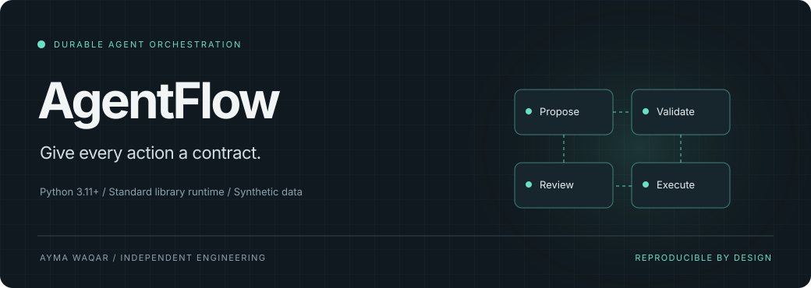
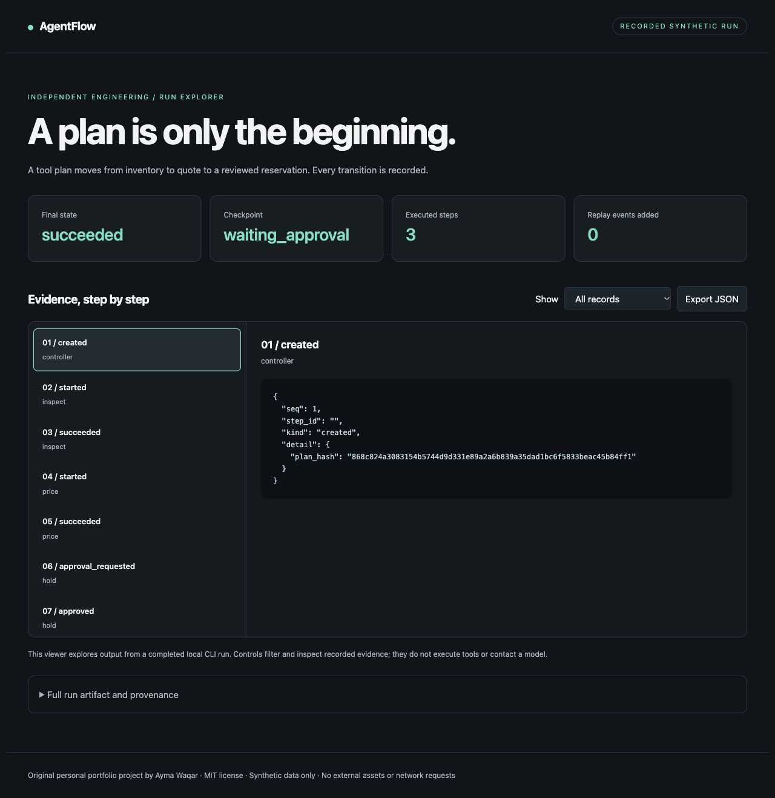
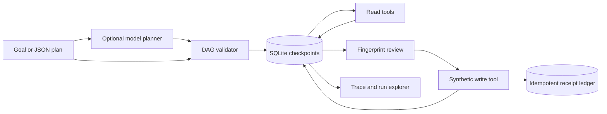

<p align="center"></p>

<p align="center">
<a href="https://github.com/aymaw/agentflow/actions/workflows/ci.yml"></a>


<a href="LICENSE"></a>
</p>

<p align="center"><b>A compact agent runtime that turns tool plans into durable, reviewable execution.</b></p>
<p align="center"><a href="#try-it-in-a-minute">Quickstart</a> · <a href="docs/architecture.md">Architecture</a> · <a href="docs/tutorial.md">Walkthrough</a> · <a href="docs/demo.html">Run explorer</a> · <a href="docs/scope.md">Scope</a></p>

AgentFlow separates a planner’s proposal from the authority to execute it. A plan becomes a validated DAG; reads can retry, writes pause for review, and every result survives a process restart in SQLite.

## Why this exists

A tool call can outlive the process that requested it. A timeout is not proof of failure, and an old approval is not permission for a changed action. AgentFlow makes those boundaries explicit in an implementation you can read in an afternoon.

## Try it in a minute

Python 3.11 or later. The demo needs no packages, account, model download, or API key.

```sh
git clone https://github.com/aymaw/agentflow.git
cd agentflow
python3 -m agentflow demo --html .runs/demo.html
python3 -m unittest discover -s tests -v
```

Open `.runs/demo.html` in a browser to inspect the recorded run. JSON is printed
to stdout. The explorer filters records and shows their exact evidence; it does
not execute tools or make network requests. A captured run is in
[`examples/demo.json`](examples/demo.json). Download [`docs/demo.html`](docs/demo.html)
to open the checked-in viewer; GitHub source view does not execute HTML.

```text
checkpoint: waiting_approval
final_status: succeeded
replay_adds_events: 0
synthetic sensor-kit stock: 12 → 9
```

The default is a **deterministic synthetic demonstration**. The optional model
path calls your explicitly configured endpoint. Demo results are not live model
measurements. All included records and entities are fictional.

<details>
<summary>See the recorded run explorer</summary>



</details>

## What is implemented

| Capability | Concrete behavior |
| --- | --- |
| **Durable DAG execution** | Validated dependencies, output references, tool allowlists, and version-pinned effect policies. |
| **Bound approval** | A fingerprint binds review to the plan, resolved arguments, and tool version. |
| **Conservative recovery** | Interrupted reads can recover; interrupted or failed writes become uncertain until manually reconciled. |
| **Replayable evidence** | Ordered transitions, stable idempotency keys, bounded retries, and a synthetic reservation ledger. |

## How it works



The [architecture contract](docs/architecture.md) explains state transitions,
transaction boundaries, failure handling, and the exact guarantees.

## Use it from Python

```python
from agentflow.engine import Engine
from agentflow.tools import warehouse_tools
from agentflow.cli import demo_plan

engine = Engine("runs.sqlite", warehouse_tools("warehouse.sqlite"))
try:
    run = engine.start(demo_plan())
    checkpoint = engine.advance(run)
    pending = next(s for s in checkpoint["steps"] if s["status"] == "waiting_approval")
    engine.approve(run, pending["id"], pending["fingerprint"], "local-reviewer")
    assert engine.advance(run)["status"] == "succeeded"
finally:
    engine.close()
```

For an installed command, run `python3 -m pip install .`, then `agentflow --help`.
Installation needs setuptools as a build dependency; the runtime has no external
dependencies. Module commands above run directly from the checkout offline.

## Bring a model

The optional JSON transport works with a compatible local or remote chat endpoint.
It sends no data until a model command is called.

```sh
export MODEL_BASE_URL=http://127.0.0.1:11434/v1
export MODEL_NAME=your-installed-model
# For an authenticated endpoint, set MODEL_API_KEY in your environment.
python3 -m agentflow plan "Quote and reserve 3 sensor-kit units after review"
```

Use a model already installed at that endpoint. No weights are downloaded or
distributed. Remote endpoints require HTTPS. Redirects are disabled, requests
are bounded to 64 KB, responses to 1 MB, and requests time out after 30 seconds.
Model proposals pass deterministic checks before domain changes. Read the
[transport contract](docs/model-provider.md) and [security notes](SECURITY.md).

## Engineering checks

DAG validation, stale approvals, restart/replay, retry exhaustion, changed tool policies, concurrent claims, idempotency conflicts, and uncertain writes.

CI tests, builds and installs the package, checks formatting and lint, compiles
modules, and produces a demo artifact. The configured matrix covers Python
3.11–3.14 on Linux and Python 3.13 on macOS and Windows. A verified green remote
run requires publication and an actual successful Actions run.

```sh
make check
# Optional contributor tooling:
python3 -m pip install '.[dev]'
ruff check .
ruff format --check .
```

Local evidence: [verification record](docs/validation.md).

## Scope

This is a synchronous, single-controller reference runtime. It has no
distributed queue, leases, cancellation, automatic backoff, or parallel scheduler.
SQLite is not a distributed transaction with arbitrary external services. Generic
tool writes do **not** have an exactly-once guarantee. Manual reconciliation
trusts an operator's supplied receipt. Reviewer labels are not authenticated
identities. The default planner is scripted; the opt-in model planner is a
separate, untrusted proposal source.

Original personal portfolio work, with no employer affiliation or copied company
implementation. [Provenance](docs/provenance.md) · [MIT license](LICENSE) ·
[Contributing](CONTRIBUTING.md) · [Changelog](CHANGELOG.md)
