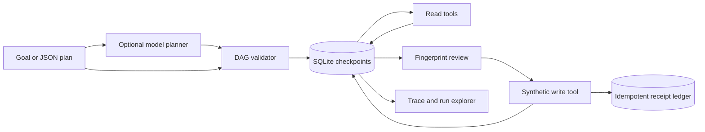

# AgentFlow architecture

## Execution contract

The planner returns an object containing only `steps`. Each step has exactly
`id`, `tool`, `args`, and `needs`. Plans contain 1–32 steps. References use
`{"$ref":"step.field"}` and name explicit dependencies. Cycles, unknown tools,
duplicate IDs, and missing dependencies fail before creation. Tool arguments are
validated after references resolve.

Read failures retry only when an adapter raises `TransientError`, up to the
pinned attempt limit. Effectful exceptions always become uncertain. The engine
commits a claim before calling a tool and its result afterward. A second controller
observing a running step stops instead of duplicating it.

Tools declare effect policy, version, validator, and execution function. Authors
must bump versions when behavior changes. Versions are not source signatures.
The synthetic warehouse atomically commits stock and receipt and rejects a
reused idempotency key with different arguments.

## Code map

| Location | Responsibility |
| --- | --- |
| `agentflow/engine.py` | Domain behavior, invariants, and transitions |
| `agentflow/cli.py` | Module and installed commands; synthetic demo |
| `agentflow/provider.py` | Opt-in bounded JSON model transport |
| `agentflow/report.py` | Self-contained run explorer |
| `tests/` | Domain, CLI, and transport regressions |
| `examples/` | Synthetic inputs and captured outputs |

## Authority and trust

The local caller controls files, reviewer labels, and endpoint configuration.
Model output has no special privileges. A hash binds content, not human identity.
The database and Python process are trusted. A hosted deployment would require
identity, access control, secret management, resource limits, monitoring, and
operational review.

## Boundaries

This is a synchronous, single-controller reference runtime. It has no
distributed queue, leases, cancellation, automatic backoff, or parallel scheduler.
SQLite is not a distributed transaction with arbitrary external services. Generic
tool writes do **not** have an exactly-once guarantee. Manual reconciliation
trusts an operator's supplied receipt. Reviewer labels are not authenticated
identities. The default planner is scripted; the opt-in model planner is a
separate, untrusted proposal source.
